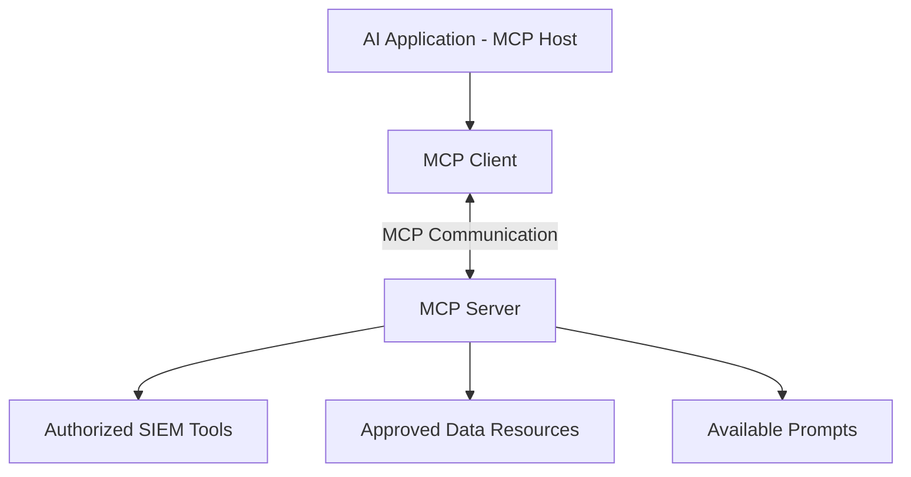
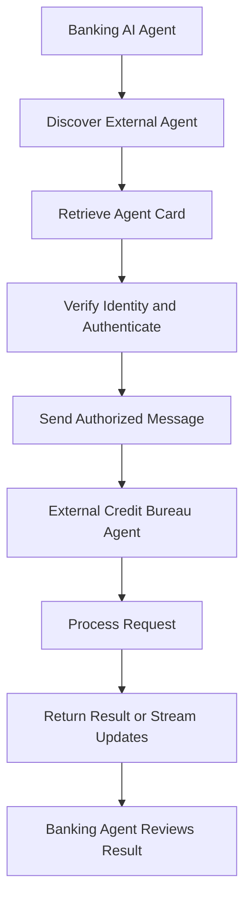
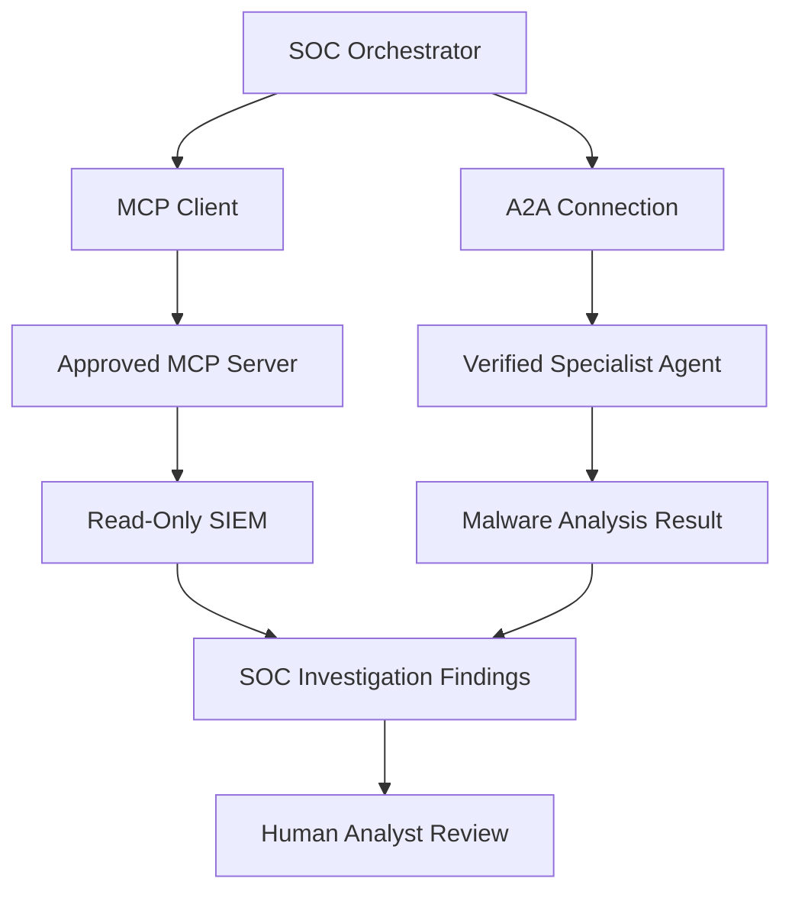

# Task 5: Agent Communication — MCP and A2A

**Learning Path:** TryHackMe Agentic AI Security  
**Topic:** Model Context Protocol and Agent-to-Agent Communication  
**Type:** Technical Study Notes and Security Analysis  
**Status:** Study Notes Prepared

## 1. Learning Objectives

- Explain how agents communicate with external tools and independent agents.
- Identify the three MCP architectural roles.
- Describe A2A discovery, authentication, and messaging.
- Compare MCP and A2A communication patterns.
- Identify trust boundaries and recommended security controls.
- Apply both protocols to a security operations scenario.

## 2. Model Context Protocol (MCP)

Model Context Protocol (MCP) is an open standard that connects AI applications to external tools, data, and resources through a consistent interface.

### MCP Architecture

MCP defines three roles:

1. **Host:** The AI application coordinating user interaction and tool access.
2. **Client:** A component within the host that maintains a connection to an MCP server.
3. **Server:** A program that exposes tools, resources, and prompts.

An MCP server can provide access to a SIEM, file repository, database, or internal API.

### MCP Architecture Diagram

**Security observation:** MCP standardizes communication but does not automatically make connected tools trustworthy or authorized.

## 3. Agent-to-Agent Protocol (A2A)

Agent-to-Agent (A2A) enables independent AI agents to discover each other's capabilities, exchange messages, and coordinate delegated tasks.

### Four Communication Stages

1. **Discovery:** Retrieve an external agent's Agent Card to learn its capabilities and supported communication methods.
2. **Authentication:** Establish the required identity and authorization context.
3. **sendMessage:** Submit a request and receive a response or task information.
4. **sendMessageStream:** Optionally receive incremental updates for longer-running operations.

Agent discovery and authentication information may be reused where appropriate.

### A2A Communication Diagram

**Security observation:** An Agent Card describes capabilities and authentication requirements, but its contents must not be treated as proof that an agent is trustworthy.

## 4. MCP vs A2A

| Feature | MCP | A2A |
|---|---|---|
| Full name | Model Context Protocol | Agent-to-Agent |
| Primary purpose | Connect applications to tools and data | Connect independent agents |
| Main roles | Host, Client, Server | Requesting and remote agents |
| Discovery | Server capabilities | Agent Cards |
| Interaction | Tool and resource access | Task delegation and messaging |
| SOC example | Query SIEM logs | Delegate malware analysis |

Both protocols may operate within the same agentic application.

## 5. Combined Agent Communication Architecture

This is a conceptual architecture, not a deployed production system.

## 6. Security Risks and Recommended Controls

| Risk | Impact | Recommended Control |
|---|---|---|
| Malicious MCP server | Untrusted tools or manipulated results | Server allowlisting and endpoint verification |
| Excessive tool privileges | Unauthorized access or changes | Least-privilege access |
| Prompt injection | Untrusted data influences agent behavior | Separate external content from instructions |
| Agent impersonation | Requests or results from an attacker | Strong authentication and identity verification |
| Malicious Agent Card | Misleading capabilities or endpoint information | Validate sources and enforce approved destinations |
| Unauthorized delegation | Sensitive data sent to another agent | Delegation policies and data minimization |
| Data exfiltration | Confidential information leaves trusted systems | Egress controls and access restrictions |
| Missing audit logs | Poor incident visibility | Centralized monitoring and traceability |

**Key principle:** Protocol support is not equivalent to authorization. The application must independently enforce its security policies.

## 7. SOC Security Operations Use Case

**Scenario:** An AI SOC assistant investigates suspicious endpoint activity.

1. The SOC orchestrator receives an endpoint security alert.
2. An MCP client connects to an approved security server.
3. The agent retrieves permitted, read-only telemetry.
4. The orchestrator identifies a need for specialized malware analysis.
5. Through A2A, the application contacts an approved specialist agent.
6. The specialist returns an analysis result.
7. The orchestrator correlates the findings.
8. A human analyst reviews the investigation and approves any disruptive response.

### Defensive Recommendations

- Use read-only permissions for initial investigation.
- Restrict communication to approved servers and agents.
- Authenticate and authorize every external connection.
- Validate tool results and external agent responses.
- Avoid transmitting secrets or unnecessary personal information.
- Log delegation requests and tool execution.
- Require approval before containment or account-disabling actions.

## 8. TryHackMe Knowledge Check

**Q1: What standard connects AI agents to tools and data?**

Answer: Model Context Protocol (MCP)

**Q2: What are the three MCP roles?**

Answer: Host, Client, Server

**Q3: What protocol supports communication with external agents?**

Answer: Agent-to-Agent (A2A)

## 9. Key Takeaways

- MCP standardizes connections between AI applications and external tools.
- MCP defines Host, Client, and Server roles.
- A2A supports communication and task delegation between independent agents.
- Agent Cards advertise capabilities and connection requirements.
- MCP and A2A can be used together.
- External tools and agents introduce additional trust boundaries.
- Strong authentication, least privilege, validation, and logging are essential.

## 10. Portfolio Reflection

This lesson improved my understanding of how autonomous AI systems communicate beyond their own application boundaries.

From a cybersecurity perspective, I identified external MCP servers, tool outputs, Agent Cards, and delegated agent responses as important areas requiring trust validation and authorization.

I also designed a conceptual SOC architecture combining MCP-based SIEM access with A2A-based specialist analysis and human review.

## References

- [TryHackMe Agentic AI Security Path](https://tryhackme.com/path/outline/agentic-ai-security)
- [Model Context Protocol](https://modelcontextprotocol.io/)
- [A2A Protocol](https://a2a-protocol.org/)
- [OWASP GenAI Security Project](https://genai.owasp.org/)
- [Anthropic MCP Announcement](https://www.anthropic.com/news/model-context-protocol)

---

*Independent educational study notes and conceptual security architecture. The SOC scenario is illustrative; no practical implementation or completed lab is claimed.*
