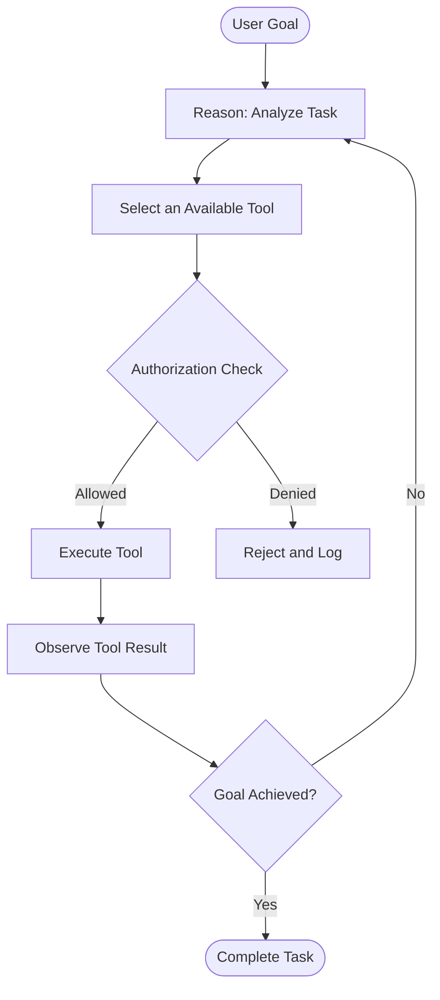

# Task 3: ReAct, Tool Use, and Agent-Computer Interface

**Learning Path:** TryHackMe Agentic AI Security  
**Topic:** Reasoning, Acting, Tool Execution, and ACI  
**Type:** Technical Study Notes and Security Analysis  
**Status:** Study Notes Prepared

## 1. Learning Objectives

- Explain the ReAct reasoning-and-acting approach.
- Understand how tool execution provides feedback to AI agents.
- Identify the components of a tool definition, request, and result.
- Explain Agent-Computer Interface (ACI) design.
- Analyze security risks associated with tool execution.
- Apply the concepts to a SOC investigation scenario.

## 2. What Is ReAct?

ReAct is an approach that combines reasoning and acting so an AI agent can interact with external systems, observe results, and adapt its next steps.

Instead of relying exclusively on generated answers, an agent can use tools to gather evidence.

**Core cycle:**

Reason → Act → Observe → Reason Again

### ReAct Architecture Diagram



**Security note:** The authorization check is a recommended defensive control added to this conceptual ReAct workflow.

## 3. What Are Agent Tools?

Tools enable AI agents to interact with external applications, databases, APIs, and security systems.

A tool definition typically includes:

- **Name:** Identifies the tool.
- **Description:** Explains its purpose.
- **Input schema:** Defines required parameters.
- **Execution logic:** Application code that performs the operation.
- **Result:** Data returned to the agent after execution.

### Example: Employee Role Lookup

The following is a simplified educational example.

**Tool definition:**

```json
{
  "name": "check_role",
  "description": "Look up an employee role and permissions.",
  "input_schema": {
    "type": "object",
    "properties": {
      "employee_id": {
        "type": "string"
      }
    },
    "required": ["employee_id"]
  }
}
```

**Tool request:**

```json
{
  "type": "tool_use",
  "name": "check_role",
  "input": {
    "employee_id": "e-4471"
  }
}
```

**Illustrative tool result:**

```json
{
  "role": "ml-engineer",
  "employment_type": "contract",
  "permitted_scopes": [
    "training-data-buckets:read"
  ]
}
```

The model requests tool execution, but the application must independently authorize and execute the operation.

## 4. Agent-Computer Interface (ACI)

Agent-Computer Interface is the practice of designing tools and applications so AI agents can interact with them effectively.

Good ACI design includes:

- Clear tool names and descriptions
- Well-defined input schemas
- Predictable responses
- Useful error messages
- Minimal and explicit permissions
- Security logging and monitoring

ACI improves reliability and can help reduce unsafe tool interactions.

## 5. Agentic AI Security Risks

| Risk | Description | Recommended Control |
|---|---|---|
| Prompt injection | Untrusted content influences agent behavior | Separate instructions from external data |
| Unauthorized tool calls | Agent attempts prohibited operations | Independent authorization checks |
| Excessive permissions | Tools have broader access than necessary | Least privilege |
| Data exfiltration | Agent transfers sensitive information | Data access and egress restrictions |
| Unsafe execution | Agent executes harmful operations | Validation, sandboxing, and approvals |
| Tool-result manipulation | Malicious tool output influences reasoning | Treat tool responses as untrusted input |

## 6. SOC Investigation Use Case

**Scenario:** A SOC AI assistant investigates suspicious authentication activity.

1. **Reason:** Identify the affected user and determine which evidence is required.
2. **Act:** Query an authorized SIEM tool.
3. **Observe:** Review authentication logs and related alerts.
4. **Reason again:** Correlate findings with threat intelligence.
5. **Act:** Create an incident ticket if permitted.
6. **Report:** Summarize findings and recommend next steps.

### Recommended Security Controls

- Use read-only permissions for initial investigations.
- Require approval for account disabling or other disruptive actions.
- Log tool requests and execution results.
- Validate tool inputs.
- Treat external logs and tool outputs as untrusted data.
- Avoid exposing credentials and sensitive information.

## 7. TryHackMe Knowledge Check

**Q1: What do agents use to perform actions in the real world?**

Answer: Tools

**Q2: What practice focuses on designing applications for efficient agent interaction?**

Answer: Agent-Computer Interface (ACI)

## 8. Key Takeaways

- ReAct combines reasoning with actions and observations.
- Tools connect AI decisions to external systems.
- Tool execution feedback helps ground subsequent reasoning.
- Tool definitions specify names, descriptions, and parameters.
- ACI improves agent interaction with applications.
- Authorization must be enforced outside the AI model.
- Tool outputs are not inherently trustworthy.

## 9. Portfolio Reflection

This lesson helped me understand how autonomous agents use tools to gather information and perform actions.

From a cybersecurity perspective, the critical insight is that tool access introduces a security boundary between AI-generated decisions and application execution.

I identified authorization enforcement, least privilege, input validation, human approval, and audit logging as important controls for securing agentic workflows.

## References

- [TryHackMe Agentic AI Security Path](https://tryhackme.com/path/outline/agentic-ai-security)
- [ReAct Research Paper](https://arxiv.org/abs/2210.03629)
- [OWASP GenAI Security Project](https://genai.owasp.org/)

---

*Independent educational study notes. The tool examples and SOC scenario are illustrative, not records of completed practical labs.*
