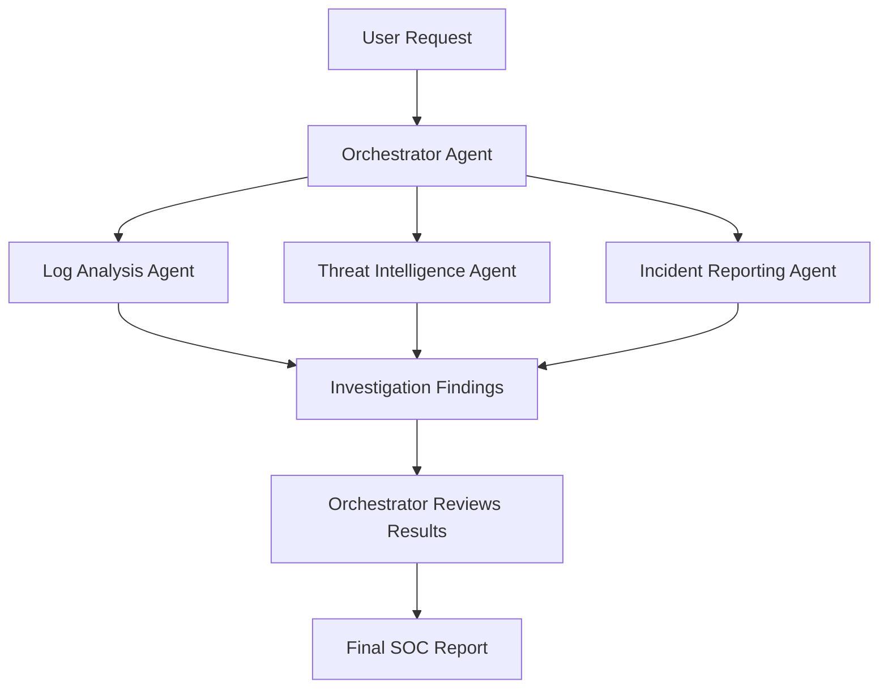
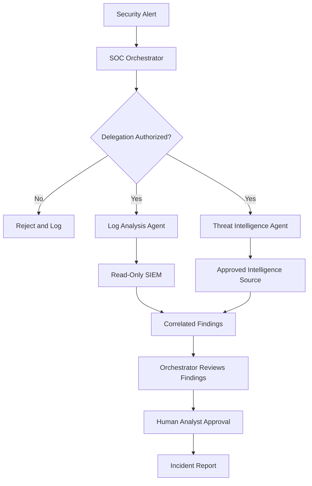

# Task 4: Multi-Agent Systems — Architecture and Security

**Learning Path:** TryHackMe Agentic AI Security  
**Topic:** Multi-Agent Architecture, Orchestration, Delegation, and Security  
**Type:** Technical Study Notes and Security Analysis  
**Status:** Study Notes Prepared

## 1. Learning Objectives

- Explain why organizations use multiple AI agents.
- Describe the orchestrator-workers architecture.
- Understand how orchestrators delegate tasks to specialized sub-agents.
- Identify the benefits and operational trade-offs of multi-agent systems.
- Analyze security risks introduced by agent delegation.
- Apply multi-agent architecture to a SOC investigation scenario.

## 2. What Is a Multi-Agent System?

A multi-agent system consists of multiple AI agents that collaborate to accomplish a shared goal.

Instead of relying on a single general-purpose agent, a multi-agent system distributes work among specialized agents.

Each agent can have its own instructions, tools, permissions, and execution context.

### Common Architecture: Orchestrator-Workers

The **orchestrator** is responsible for coordinating the overall task.

It can:

1. Receive a user request.
2. Break the request into smaller tasks.
3. Select appropriate specialized agents.
4. Delegate tasks to those agents.
5. Collect and evaluate their results.
6. Produce a consolidated response.

Sub-agents perform their assigned tasks and report results back to the orchestrator.

## 3. Multi-Agent Architecture Diagram

**Security note:** The diagram is conceptual. In a production system, authorization checks should protect agent delegation, tool access, and data exchange.

## 4. Why Use Multiple Agents?

### 4.1 Scoped Identity and Reduced Blast Radius

Each agent can receive credentials appropriate to its specific responsibilities.

For example, a log analysis agent may need read-only SIEM access, while a reporting agent only needs permission to create incident drafts.

Separating identities can reduce the impact of a compromised agent.

### 4.2 Reduced Path Dependency

Independent agents can work with separate reasoning contexts.

An incorrect assumption in one agent's reasoning does not necessarily contaminate every other agent's investigation.

However, the orchestrator must still validate and correlate their results.

### 4.3 Specialization

Agents can focus on narrower responsibilities and smaller sets of tools.

Examples include:

- Log analysis
- Threat intelligence enrichment
- Malware investigation
- Incident report preparation

### 4.4 Speed Through Parallel Execution

Independent subtasks can execute concurrently.

For example, one agent may analyze authentication logs while another checks suspicious IP addresses against threat intelligence.

This can reduce total investigation time when tasks are independent.

## 5. Trade-Offs and Limitations

Multi-agent systems introduce additional complexity.

| Trade-Off | Description |
|---|---|
| Token consumption | Multiple agents may require substantially more model tokens |
| Coordination overhead | The orchestrator must manage task delegation and results |
| Debugging complexity | Failures can occur across multiple agents |
| Increased attack surface | More tools, credentials, and communication paths |
| Unpredictable behavior | Agents may produce conflicting or inconsistent findings |

Anthropic has reported that multi-agent systems can consume up to approximately **15 times** the tokens of a single conversation in its research-system context.

This is not a universal performance or cost multiplier.

## 6. How Agent Delegation Works

In many frameworks, sub-agents are exposed to the orchestrator as callable tools.

A typical delegation process is:

1. The orchestrator identifies a specialized task.
2. It selects an available sub-agent.
3. The framework passes the task to that sub-agent.
4. The sub-agent performs its own reasoning and tool operations.
5. The sub-agent returns its findings.
6. The orchestrator incorporates the results into its response.

Examples of this design include:

- Anthropic's orchestrator-workers pattern
- OpenAI Agents SDK handoffs
- LangChain supervisor and sub-agent patterns

The exact implementation differs by framework.

## 7. Security Risks in Multi-Agent Systems

| Security Risk | Potential Impact | Recommended Control |
|---|---|---|
| Shared credentials | Compromise affects multiple agents | Unique identities per agent |
| Excessive permissions | Unauthorized tool execution | Least-privilege access |
| Unauthorized delegation | Tasks reach unapproved agents | Agent allowlisting |
| Prompt injection | Malicious content redirects an agent | Trusted instruction boundaries |
| Agent impersonation | Attacker-controlled agent receives tasks | Agent authentication |
| Sensitive data leakage | Confidential data reaches another agent | Data minimization |
| Manipulated agent results | Incorrect orchestrator decisions | Output validation |
| Missing audit trails | Difficult incident investigation | Centralized logging |

**Important:** Agent specialization alone does not guarantee security. Permissions and authorization must be enforced by trusted infrastructure.

## 8. Secure Multi-Agent SOC Architecture

This architecture demonstrates recommended security boundaries:

- Authorization before task delegation.
- Separate agent responsibilities.
- Restricted access to approved tools.
- Read-only access for investigation.
- Human oversight before high-impact actions.
- Auditable investigation results.

## 9. SOC Investigation Use Case

### Scenario: Suspicious Authentication Activity

A SOC platform generates an alert after multiple failed login attempts followed by a successful login.

**Step 1 — Alert Intake**

The SOC orchestrator receives the alert and determines which investigations are required.

**Step 2 — Log Analysis**

The log analysis agent examines relevant authentication events using approved read-only access.

**Step 3 — Threat Intelligence**

A separate agent checks the suspicious source IP against approved threat intelligence sources.

**Step 4 — Findings Collection**

Both agents return their observations to the orchestrator.

**Step 5 — Correlation**

The orchestrator compares the findings and prepares an investigation summary.

**Step 6 — Human Review**

A SOC analyst reviews the report and determines whether additional response actions are justified.

### Expected Benefits

- Parallel investigation activities
- Specialized analysis
- Reduced unnecessary credential sharing
- Improved separation of duties
- Clearer investigation accountability

**Note:** This is a conceptual SOC scenario, not a completed hands-on lab.

## 10. TryHackMe Knowledge Check

**Question 1:** How many times more tokens can a multi-agent system use than a single conversation?

**Answer:** 15

**Question 2:** What is the name of the agent that all sub-agents report back to?

**Answer:** Orchestrator

## 11. Key Takeaways

- Multi-agent systems distribute tasks among specialized AI agents.
- An orchestrator coordinates delegation and collects results.
- Separate agents can improve specialization and parallelism.
- Independent identities can help limit security blast radius.
- Multi-agent systems increase coordination and monitoring requirements.
- Least privilege and authorization are critical for secure delegation.
- Human review remains important for high-impact security operations.

## 12. Portfolio Reflection

This lesson strengthened my understanding of multi-agent architectures and the security implications of autonomous task delegation.

I studied the orchestrator-workers pattern, compared its benefits and trade-offs, and identified important security controls for specialized agents.

I also designed a conceptual multi-agent SOC investigation workflow incorporating authorization, restricted tool access, separate agent responsibilities, and human oversight.

These concepts are relevant to building secure AI-assisted security operations systems.

## References

- [TryHackMe](https://tryhackme.com/)
- [Anthropic: Building Effective Agents](https://www.anthropic.com/engineering/building-effective-agents)
- [Anthropic: Multi-Agent Research System](https://www.anthropic.com/engineering/multi-agent-research-system)
- [OpenAI Agents SDK: Handoffs](https://openai.github.io/openai-agents-python/handoffs/)
- [LangChain: Multi-Agent Subagents](https://docs.langchain.com/oss/python/langchain/multi-agent/subagents-personal-assistant)
- [OWASP Agentic AI Threats and Mitigations](https://genai.owasp.org/resource/agentic-ai-threats-and-mitigations/)

---

*Independent educational study notes and conceptual security architecture. The SOC examples are illustrative and do not represent completed practical labs or deployed systems.*
  
