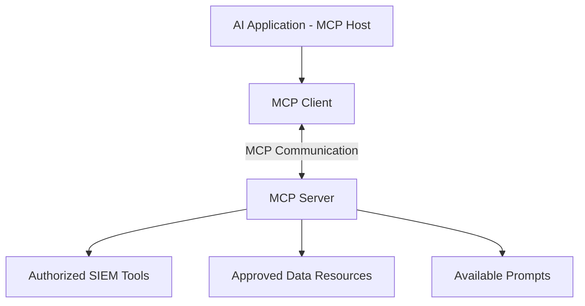
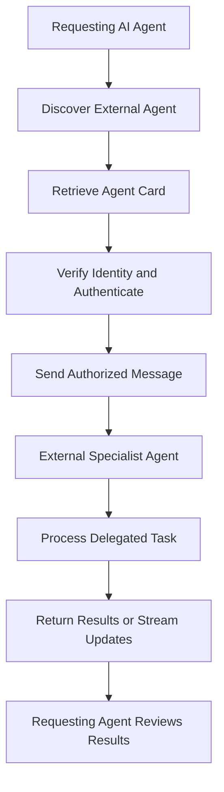
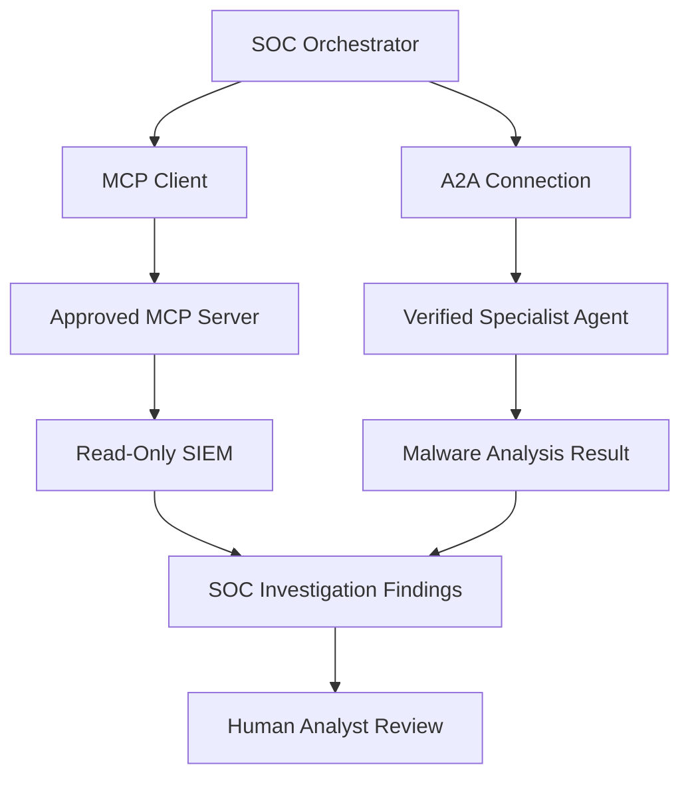

# Task 5: Agent Communication — MCP and A2A

**Learning Path:** TryHackMe Agentic AI Security  
**Topic:** Model Context Protocol and Agent-to-Agent Communication  
**Type:** Technical Study Notes and Security Analysis  
**Status:** Study Notes Prepared

## 1. Learning Objectives

- Explain how AI agents communicate with external tools and systems.
- Identify the three architectural roles of MCP.
- Describe A2A agent discovery, authentication, and messaging.
- Compare MCP and A2A communication.
- Identify security risks involving external tools and agents.
- Apply secure communication principles to SOC operations.

## 2. Model Context Protocol (MCP)

Model Context Protocol (MCP) is an open standard for connecting AI applications to external tools, resources, and data sources.

MCP helps developers integrate external capabilities without creating a completely different connection mechanism for every service.

### Three MCP Roles

1. **Host:** The AI application coordinating user interaction and tool access.
2. **Client:** A component that maintains a connection to an MCP server.
3. **Server:** A program that exposes tools, resources, and prompts.

### MCP Architecture Diagram

**Security consideration:** MCP standardizes communication but does not automatically make an external server trustworthy.

## 3. Agent-to-Agent Protocol (A2A)

Agent-to-Agent (A2A) is a protocol that enables independent AI agents to communicate, delegate tasks, and exchange results.

A2A is useful when an application needs to interact with an agent operated by another organization.

### Four A2A Communication Stages

**1. Discovery**

The requesting application retrieves an external agent's Agent Card to learn its capabilities and connection requirements.

**2. Authentication**

The application authenticates using the method supported by the external agent.

**3. sendMessage**

The requesting agent sends a structured message to the external agent.

**4. sendMessageStream (optional)**

For longer-running tasks, the external agent can stream updates rather than returning only one final response.

### A2A Communication Diagram

**Security consideration:** An Agent Card advertises capabilities and connection requirements, but it should not be treated as independent proof of trustworthiness.

## 4. MCP vs. A2A

| Feature | MCP | A2A |
|---|---|---|
| Full name | Model Context Protocol | Agent-to-Agent |
| Primary purpose | Connect applications to tools and data | Connect independent agents |
| Main roles | Host, Client, Server | Requesting and remote agents |
| Discovery | Server capabilities | Agent Cards |
| Interaction | Tool calls and resource access | Agent messaging and delegation |
| SOC example | Retrieve SIEM logs | Delegate malware analysis |

MCP and A2A are complementary rather than competing protocols.

An AI application can use MCP to access tools and A2A to collaborate with independent agents.

## 5. Combined Agent Communication Architecture

This diagram represents a conceptual SOC architecture, not a deployed system.

## 6. Security Risks and Recommended Controls

| Security Risk | Potential Impact | Recommended Control |
|---|---|---|
| Malicious MCP server | Manipulated tool outputs | Server allowlisting and verification |
| Excessive permissions | Unauthorized actions | Least-privilege access |
| Prompt injection | Agent behavior manipulation | Separate external data from instructions |
| Agent impersonation | Unauthorized communication | Strong identity verification |
| Malicious Agent Card | Misleading capabilities or endpoints | Validate sources and approved destinations |
| Unauthorized delegation | Sensitive data exposure | Delegation policies |
| Data exfiltration | Confidential information leakage | Egress controls and data minimization |
| Missing audit logs | Reduced investigation visibility | Centralized audit logging |

### Recommended Security Principles

- Authenticate external servers and agents.
- Authorize each tool operation independently.
- Restrict access to approved resources.
- Use short-lived credentials where possible.
- Validate external tool and agent responses.
- Maintain audit logs of communications and delegated tasks.
- Require human approval for high-impact operations.

**Key principle:** A protocol connection does not automatically grant permission to perform an action.

## 7. SOC Investigation Use Case

### Scenario: Suspicious Endpoint Activity

A security monitoring platform generates an alert indicating potentially malicious endpoint behavior.

**Step 1 — Alert Intake**

The SOC orchestrator receives the alert.

**Step 2 — MCP Tool Access**

The orchestrator uses an approved MCP connection to retrieve relevant security telemetry.

**Step 3 — Investigation**

The agent reviews logs and identifies suspicious indicators.

**Step 4 — A2A Delegation**

The orchestrator sends an authorized analysis request to an approved specialist agent.

**Step 5 — Specialist Analysis**

The specialist agent returns its findings.

**Step 6 — Correlation**

The orchestrator combines telemetry and specialist findings.

**Step 7 — Human Review**

A SOC analyst evaluates the findings and approves any necessary disruptive response.

### Security Benefits

- Controlled external communication
- Restricted tool permissions
- Specialized analysis
- Better auditability
- Human oversight

**Note:** This is an illustrative design scenario, not a completed hands-on lab.

## 8. TryHackMe Knowledge Check

**Question 1:** What is the shared standard for connecting an AI agent to tools and data?

**Answer:** Model Context Protocol (MCP)

**Question 2:** What are the three MCP roles?

**Answer:** Host, Client, Server

**Question 3:** What term describes communication with an external agent?

**Answer:** Agent-to-Agent (A2A)

## 9. Key Takeaways

- MCP standardizes connections to tools, resources, and data.
- MCP defines Host, Client, and Server roles.
- A2A enables communication between independent agents.
- Agent Cards support external agent discovery.
- MCP and A2A can be combined in one architecture.
- External communication introduces additional trust boundaries.
- Authentication, authorization, least privilege, and logging are essential.

## 10. Portfolio Reflection

This lesson strengthened my understanding of how autonomous AI systems communicate with external tools and independent agents.

I studied MCP and A2A architectures, identified important trust boundaries, and examined security risks involving agent discovery, tool execution, and delegated tasks.

I also designed a conceptual SOC communication architecture incorporating restricted SIEM access, external specialist analysis, and human oversight.

## References

- [TryHackMe](https://tryhackme.com/)
- [Model Context Protocol](https://modelcontextprotocol.io/)
- [A2A Protocol](https://a2a-protocol.org/)
- [OWASP GenAI Security Project](https://genai.owasp.org/)
- [Anthropic MCP Announcement](https://www.anthropic.com/news/model-context-protocol)

---

*Independent educational study notes and conceptual security architecture. The SOC example is illustrative and does not represent a completed practical lab or deployed system.*
