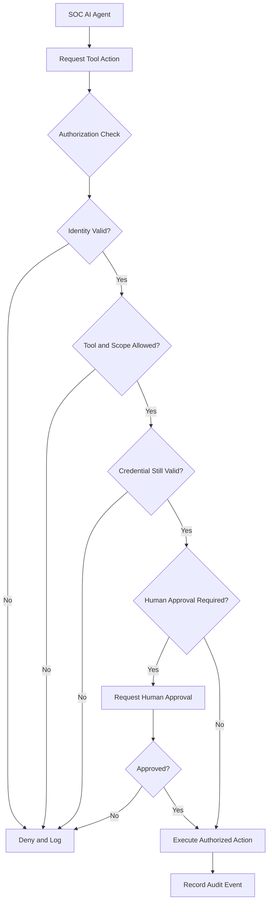

# Task 6: Least Agency — Securing Autonomous AI Agents

**Learning Path:** TryHackMe Agentic AI Security  
**Topic:** Least Agency, Least Privilege, and Excessive Agency  
**Type:** Technical Study Notes and Security Analysis  
**Status:** Study Notes Prepared

## 1. Learning Objectives

- Define the principle of Least Agency.
- Explain how Least Agency extends traditional least privilege.
- Identify security risks introduced by autonomous decision-making.
- Describe time-boxed permissions and per-agent identities.
- Explain how to secure agent delegation and tool access.
- Apply Least Agency principles to SOC automation.

## 2. What Is Least Agency?

Least Agency is the security principle of granting an AI agent only the autonomy, permissions, tools, and access duration necessary to accomplish its authorized task.

The concept combines traditional least-privilege principles with controls against excessive agency.

### Least Privilege vs. Least Agency

| Principle | Focus |
|---|---|
| Least Privilege | Limit access to only what is required |
| Excessive Agency | Risk created by unnecessary agent capabilities or autonomy |
| Least Agency | Minimize permissions, autonomy, tools, and duration of access |

**Security principle:** An agent's ability to decide what action to take does not mean it should be authorized to perform every available action.

## 3. Why Least Agency Matters

Agentic AI systems introduce additional security concerns because agents can:

1. Independently select tools.
2. Execute actions against external systems.
3. Delegate tasks to sub-agents.
4. Communicate through MCP and A2A.
5. Request operations involving sensitive resources.

Without strong authorization boundaries, a compromised or misdirected agent could cause significant damage.

## 4. Core Least Agency Security Controls

### 4.1 Time-Boxed Access

Provide short-lived credentials or permissions that expire after a defined period.

**Example:** A SOC investigation agent receives temporary read-only access to security logs.

### 4.2 Per-Agent Credentials

Each agent should have its own identity and credentials.

Avoid sharing one powerful service account across multiple agents.

### 4.3 Tool-Specific Authorization

Authorize individual operations instead of granting broad access to an entire platform.

**Example:**
- Allowed: Search SIEM alerts.
- Allowed: Retrieve endpoint telemetry.
- Denied: Delete security logs.
- Denied: Disable user accounts without approval.

### 4.4 Delegation and Permission Inheritance

Track which agent delegated a task and what permissions the receiving agent can use.

Sub-agents should not automatically inherit all privileges from the orchestrator.

## 5. Least Agency Security Architecture

The following diagram illustrates how an external authorization layer can enforce least-agency controls.

**Security observation:** Authorization must be enforced by trusted application infrastructure, not solely by an AI model's instructions.

## 6. Security Risks and Recommended Mitigations

| Security Risk | Potential Impact | Recommended Control |
|---|---|---|
| Excessive permissions | Unauthorized changes | Least-privilege policies |
| Long-lived credentials | Persistent unauthorized access | Time-boxed access |
| Shared agent identities | Weak accountability | Unique agent identities |
| Unrestricted tool execution | Destructive operations | Tool-level authorization |
| Privilege inheritance | Sub-agent scope escalation | Delegation boundaries |
| Prompt injection | Manipulated agent actions | Trusted authorization checks |
| Missing audit trails | Poor incident visibility | Centralized audit logging |
| Unnecessary autonomy | Expanded attack surface | Limit autonomous capabilities |

## 7. SOC Investigation Use Case

### Scenario: Suspicious Login Investigation

A SOC AI agent receives an alert about multiple failed logins followed by a successful authentication.

**Step 1 — Alert Intake**

The agent receives the security alert.

**Step 2 — Authorized Data Collection**

The agent uses temporary, read-only access to retrieve relevant authentication events.

**Step 3 — Analysis**

The agent correlates timestamps, source IP addresses, and related activity.

**Step 4 — Recommendation**

The agent prepares a summary recommending further investigation or possible account containment.

**Step 5 — Human Approval**

If account disabling is required, an authorized analyst reviews and approves the action.

**Step 6 — Audit Logging**

The system records the agent's identity, requested operations, authorization decisions, and resulting actions.

### Expected Security Benefits

- Reduced blast radius.
- Better accountability.
- Lower risk of credential misuse.
- More controlled automation.
- Improved incident investigation traceability.

**Note:** This is an illustrative design scenario, not a completed hands-on lab.

## 8. TryHackMe Knowledge Check

**Question 1:** OWASP expanded Least Privilege and Excessive Agency into what term?

**Answer:** Least Agency

**Question 2:** Which control ensures agents hold permissions only for the required time window?

**Answer:** Time-boxed access

## 9. Key Takeaways

- Least Agency limits both access privileges and autonomous capabilities.
- AI agents should not hold unnecessary standing permissions.
- Separate identities help isolate agents and improve accountability.
- Tool-level authorization prevents unauthorized operations.
- Delegated agents require explicit permission boundaries.
- High-impact security actions may require human approval.
- Audit logging supports investigation and governance.

## 10. Portfolio Reflection

This lesson strengthened my understanding of how traditional access-control principles apply to autonomous AI systems.

I examined the risks of excessive agent privileges, persistent credentials, and uncontrolled delegation.

I also designed a conceptual SOC authorization workflow demonstrating how agent identities, permission scopes, credential expiration, and human approval can reduce the risks of autonomous security operations.

## References

- [TryHackMe Agentic AI Security](https://tryhackme.com/)
- [OWASP GenAI Security Project](https://genai.owasp.org/)
- [OWASP Agentic AI Threats and Mitigations](https://genai.owasp.org/resource/agentic-ai-threats-and-mitigations/)
- [NIST AI Risk Management Framework](https://www.nist.gov/itl/ai-risk-management-framework)

---

*Independent educational study notes and conceptual security design. No completed practical implementation or deployed SOC automation is claimed.*
