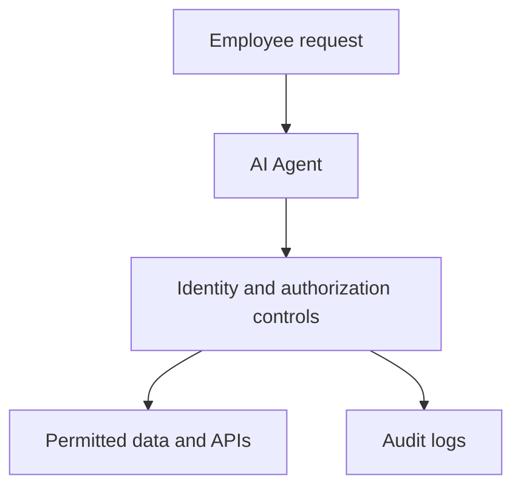

# SC-500 Study Notes — Lesson 1: Exam Overview

> Learning notes based on the supplied course transcript. Exam weights, beta details and retirement claims reflect the instructor's statements and should be checked against the current Microsoft Learn exam guide.

## What SC-500 covers

SC-500 focuses on implementing end-to-end security controls for cloud and AI workloads. Unlike SC-200's security operations emphasis, the focus here is engineering and configuring security controls.

## Four domains (instructor's stated weights)

| Domain | Weight |
|---|---|
| Identity, access, and security for AI and cloud platforms | 20–25% |
| Data, storage, databases, and networking | 25–30% |
| Compute, including AI workloads | 20–25% |
| Security posture and mitigations | 20–25% |

### 1. Identity and access
- Microsoft Entra ID, MFA, Conditional Access, RBAC, PIM and agent identity.
- **Scenario:** Require administrators to perform MFA before Azure access.
- **Solution:** Configure a Conditional Access policy targeting administrators and requiring MFA.

### 2. Data, storage and networking
- Key Vault, Azure SQL, Cosmos DB, NSGs, Azure Firewall, WAF and private endpoints.
- **Scenario:** Keep Azure SQL access off the public internet.
- **Solution:** Configure a private endpoint and restrict public network access.

### 3. Compute and AI workloads
- Virtual machines, containers, AKS, App Service and AI workload protection.
- **Scenario:** Protect an AI app against malicious instructions in retrieved content.
- **Solution:** Use prompt-injection defenses such as Prompt Shields alongside application authorization.

### 4. Security posture and mitigation
- Defender for Cloud, Sentinel, multicloud connectors and Security Copilot.
- **Scenario:** Find Azure security misconfigurations.
- **Solution:** Review Defender for Cloud recommendations.

## What changes from AZ-500?

The instructor estimates roughly 70% carryover and 30% newer material. Core topics include Conditional Access, PIM, Key Vault, firewalls, Defender for Cloud and Sentinel. Newer emphasis includes Microsoft Purview DSPM for AI, Copilot governance, Entra Agent ID, AI threat protection, AI safety controls and multicloud posture. These proportions are instructor estimates, not verified official statistics.

## AI agent identity: conceptual architecture

**Key principle:** Give an agent only the permissions required for its task. A dedicated identity improves accountability but does not automatically guarantee least privilege.

## Key terms

| Technology | Security purpose |
|---|---|
| Conditional Access | Enforce access conditions |
| PIM | Just-in-time privileged access |
| Key Vault | Store secrets, keys and certificates |
| NSG | Filter network traffic |
| Defender for Cloud | Posture assessment and workload protection |
| Microsoft Purview | Sensitive data protection and governance |
| Entra Agent ID | AI agent identity governance |
| Prompt Shields | Help mitigate prompt injection |

## Practice questions and answers

1. **Which domain is largest in the lesson?** Data, storage, databases and networking (25–30%).
2. **Which service manages just-in-time privileged roles?** Microsoft Entra Privileged Identity Management (PIM).
3. **What helps protect AI apps against malicious instructions in external content?** Prompt Shields, alongside other controls.
4. **Which service identifies Azure security misconfigurations?** Microsoft Defender for Cloud.
5. **Why scope an AI agent's permissions?** To limit the impact of misuse or compromise.

## Study approach

Study one domain at a time, practice configurations in a lab, record screenshots and document what you implemented and tested.

**Official reference:** [Microsoft Credentials](https://learn.microsoft.com/en-us/credentials/)

**Next lesson:** Microsoft Entra ID MFA and Conditional Access.
